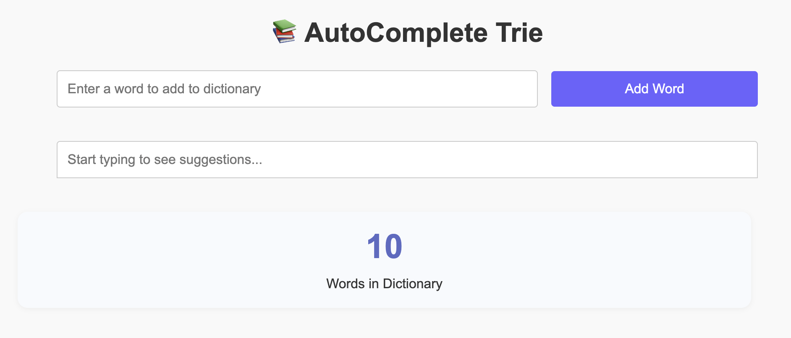
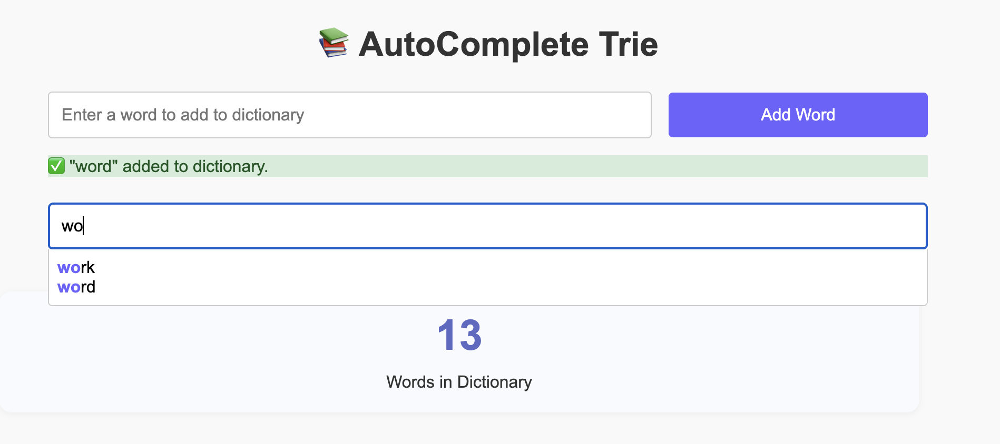
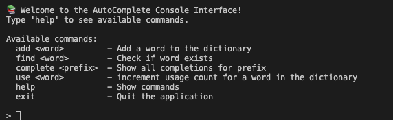

# 🔤 Autocomplete Trie Project

An interactive autocomplete application built with **JavaScript**, **HTML**, and **CSS**, powered by a **Trie (Prefix Tree)** data structure.  
It suggests ranked word completions based on user input – just like a search engine – and tracks word usage frequency.

---

## ✨ Features

- Add words dynamically via the UI
- Autocomplete suggestions by prefix
- Suggestions sorted by usage frequency
- Keyboard and mouse selection
- Tracks and displays word usage
- Preloaded word list from `defaultWords.json`
- Responsive and clean web UI
- Works both in the browser (web UI) and in the terminal (console interface)

---

## 📁 Project Structure

```
AutoComplete_Trie_Project/
│
├── assets/                 # Optional static assets
├── console/
│   └── index.js            # Console-based interface (optional)
├── data/
│   └── defaultWords.json   # Preloaded words list
├── tests/
│   └── AutoCompleteTrie.test.js # Tests for trie logic
├── trie/
│   ├── AutoCompleteTrie.js # Core Trie logic with usage tracking
│   ├── TrieNode.js         # Node structure
│   └── trieHelpers.js      # Internal helper functions
├── web/
│   ├── index.html          # Web UI HTML
│   ├── main.js             # DOM handlers + Trie connection
│   └── style.css           # Styles for UI
├── README.md
├── package.json
└── package-lock.json
```

---

## 🚀 Getting Started

1. Clone the repository:

   ```bash
   git clone https://github.com/LiorKirshner/AutoComplete_Trie_Project.git
   ```

2. Open `web/index.html` in your browser.
3. Start typing in the prefix input to test autocomplete.

---

## 🖼️ Screenshots

- 🏠 **Home View** – Initial view when entering the site:  
  

- 🔤 **Word Suggestions** – Typing in the input field shows predicted words based on the prefix:  
  

- 💻 **Terminal Interface** – The console version of the project:  
  

## 🧠 Built With

- HTML + CSS (Responsive, accessible)
- JavaScript (ES6+)
- Trie data structure with frequency logic

---

## 📌 Future Improvements

- Dark/light theme toggle
- Save words to localStorage
- Animated transitions
- Backend support for persistent word storage

---

## 👤 Author

Created by **[Lior Kirshner](https://github.com/LiorKirshner)**  
Feel free to fork, contribute or suggest improvements!
